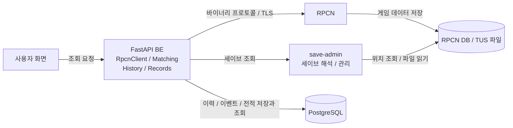

# Tag2Now: 게임 데이터 획득부터 전적 구성과 운영까지

- 구분: 개인 프로젝트, 1인 풀스택
- 서비스: https://match.tag2now.click/
- GitHub: https://github.com/orgs/tag2now/repositories
- 기술 스택: `Python` `FastAPI` `PostgreSQL` `Docker` `AWS Lightsail` `GitHub Actions`

## 게임 데이터에서 실시간 현황과 대전 전적까지

### 개요

철권 태그2 커뮤니티에서 게임 실행 전 대전 상대를 찾고, 플레이 후 상대와 결과를 확인할 수 있도록 만든 서비스입니다. 방과 랭킹은 RPCN에서 조회하고, 누적 승패와 캐릭터 정보는 세이브에서 해석합니다.

### 제공 정보

- 실시간 방과 접속자
- 매칭 중인 플레이어 추론
- 상대별 대전 전적
- 현재 계급과 리더보드
- 플레이어 활동 통계

### 시스템 구조

- 화살표: 주체 → 접근 대상
- RPCN 조회: 역공학한 Python 클라이언트
- 세이브 조회: 공유 DB 메타데이터와 TUS 파일 직접 접근
- 전적 처리: BE 내부 수집기와 소비자
- 운영 캐시: 단일 프로세스 메모리

## 핵심 개선과 성과: 바이너리 프로토콜 역공학

### 문제

- 공식 SDK와 게임별 호출 명세 부재
- 방 조회와 리더보드 호출 순서 확인 필요
- 일반 HTTP 클라이언트로 처리할 수 없는 바이너리 통신

### 해결

- Rust RPCN 서버 실행과 구현 분석
- 바이너리 헤더와 Protobuf 메시지 조합
- TLS 연결부터 로그인과 조회까지 Python 클라이언트 구현
- API 요청과 수집기가 공유하는 세션의 접근 직렬화
- 연결 실패 시 세션 폐기와 재연결 쿨다운

### 성과

- 서버 목록, 방, 리더보드와 점수 조회 기능 확보
- 단위 테스트와 실제 RPCN 연동 테스트 구성
- 조회 결과의 FastAPI 응답 변환

### 설계 판단

RPCN은 계정당 하나의 세션을 허용합니다. 요청별 연결 대신 공유 세션을 사용하고, 동시성에 안전하지 않은 소켓 접근을 잠금으로 직렬화했습니다.

## 핵심 개선과 성과: 조회되지 않는 매칭 상태 추론

### 문제

- 방 탐색 중 플레이어의 조회 응답 누락
- 현재 방 목록만으로 매칭 대기와 이탈 구분 불가

### 해결

- 연속 방 스냅샷의 차이 비교
- 1인 또는 2인 랭크 방 소멸 시 탐색 상태 전환
- 방 재등장 시 대기 또는 대전 상태 복귀
- 기본 60초 TTL로 미관측 플레이어 제거
- 탐색 중 플레이어의 Phantom Room 표시

### 성과

- 현재 응답에 없는 매칭 중 플레이어 표시
- 스냅샷 변화에 따른 상태 전이 테스트 구성

### 관측과 표시

| 관측 | 표시 상태 |
|---|---|
| 1인 랭크 방 존재 | 상대 대기 |
| 기존 랭크 방 소멸 | 방 탐색 추론 |
| 2인 랭크 방 존재 | 대전 중 |
| TTL 동안 미관측 | 표시 제거 |

### 설계 판단

방 소멸만으로 실제 탐색 상태를 확정할 수는 없습니다. 추론 결과에는 TTL을 두고, 방 관측이 다시 들어오면 상태를 갱신했습니다. 상태 보관은 현재 단일 프로세스 구성을 전제로 합니다.

## 핵심 개선과 성과: 두 데이터의 결합으로 전적 구성

### 문제

- 세이브: 승패와 캐릭터 정보 포함, 상대 정보 부재
- 방 관측: 참가자 정보 포함, 판별 승패 부재
- 같은 방에서 재대결 가능
- 전적 변화 없는 세이브 재업로드 존재

### 해결

- save-admin의 DB 메타데이터 조회와 TUS 파일 해석
- 플레이어별 직전 누적 승패와 새 세이브 비교
- 승 또는 패가 한 번 증가한 경우 판 이벤트 생성
- 저장 시각에 해당하는 방 관측으로 상대와 side 결정
- 상대 이벤트 도착 시 기존 판의 빈 side 보완

### 성과

- 상대, 승패, 캐릭터와 계급을 포함한 판별 전적 구성
- 방 재사용과 세이브 재업로드를 판수에서 구분
- 재대결, 상대 이탈, 지연 커밋의 리플레이 시나리오 구성

### 데이터별 역할

| 데이터 | 전적 구성에 사용하는 정보 |
|---|---|
| RPCN DB | 계정과 세이브 위치 |
| TUS 세이브 | 누적 승패, 캐릭터와 계급 |
| 방 관측 이력 | 참가자와 관측 시각 |
| 직전 플레이어 상태 | 누적값 변화와 대전 진입 시점의 계급 |

### 판정 범위

- 첫 관측: 기준선 저장
- 여러 판이 합쳐진 변화: 상태 갱신, 개별 판 생성 제외
- 방 미관측: 상대가 없는 전적 보존
- 세이브 원본: BE에 미보관

## 핵심 개선과 성과: PostgreSQL 영속 이벤트 큐

### 문제

- 상태 갱신과 판 이벤트 생성 사이의 누락 위험
- 양측 이벤트의 중복 판 생성 위험
- 처리 실패와 BE 재시작 후 미완료 작업 관리 필요

### 해결

| 처리 | 정합성 장치 |
|---|---|
| 세이브 비교 | 상태 갱신과 이벤트 적재의 단일 트랜잭션 |
| 이벤트 선점 | `FOR UPDATE SKIP LOCKED` |
| 상대 이벤트 결합 | 방 단위 advisory lock |
| 처리 성공 | 판 저장과 이벤트 완료 표시의 단일 트랜잭션 |
| 처리 실패 | 재시도 시각과 시도 횟수 저장 |
| 반복 실패 | 5회 실패 후 dead 상태 |
| 판정 규칙 변경 | 보존한 이벤트를 이용한 재처리 |

### 성과

- BE 내부 수집과 이벤트 처리의 독립 실행
- 미완료 이벤트의 영속 상태 관리
- 완료 이벤트 보존에 따른 판 구성 재처리 경로 확보
- save-admin 중단과 BE 재시작의 리플레이 시나리오 구성

### 설계 판단

운영 중인 PostgreSQL을 이벤트 큐로 함께 사용했습니다. 별도 브로커의 운영 부담을 추가하지 않고, 플레이어 상태와 이벤트를 같은 트랜잭션으로 다룰 수 있는 선택입니다.

### 검증 범위

- 단위 테스트: 누적값 변화와 판정 규칙
- 통합 테스트: 이벤트 선점과 저장 트랜잭션
- E2E 리플레이: 실제 BE와 save-admin 이미지의 연동
- 리플레이 밖의 확인 대상: 세이브 오프셋과 실제 저장 시점의 일치

## 핵심 개선과 성과: 운영 제약에 맞춘 구성과 캐시 개선

### 문제

- 서비스 규모 대비 ECS 기반 인프라의 고정 비용
- 단일 인스턴스의 운영 자원 제약
- 큰 JSON 캐시의 동기 디코딩에 따른 이벤트 루프 점유

### 해결

- Lightsail 단일 인스턴스와 Docker Compose 구성
- FE, BE, save-admin과 PostgreSQL 운영
- 프로세스 메모리 캐시 사용
- 플레이어 캐시 값의 필수 필드 축소
- 계급별 키 분리로 요청당 JSON 디코딩 범위 제한

### 성과

| 측정 항목 | 기존 | 변경 후 |
|---|---|---|
| 조회 시 디코딩 대상 | 전체 캐릭터 JSON 약 6MB | 최대 계급 키 약 38KB |
| JSON 디코딩 시간 | 약 60ms | 약 0.3ms |

- 측정 기준: 2026-10-01의 697명 스냅샷
- 비교 범위: 캐시 JSON 디코딩
- 변경 후 값: 가장 큰 계급 키 기준
- 운영 결과: 공개 서비스와 실사용자 제보 채널 유지

### 설계 판단

관리 요소와 비용을 줄이는 대신 단일 노드 장애 위험을 감수했습니다. 공유 RPCN 세션과 메모리 상태도 단일 프로세스를 전제로 하며, 수평 확장에는 상태 공유 방식의 변경이 필요합니다.
