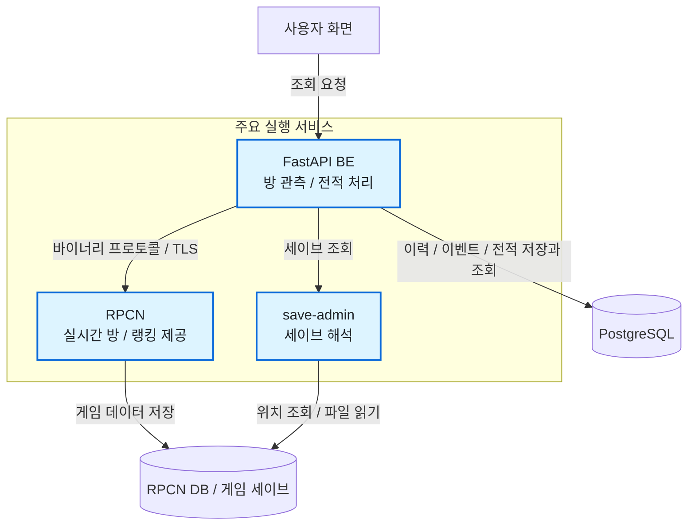

# Tag2Now: 게임 데이터 획득부터 전적 구성과 운영까지

- 구분: 개인 프로젝트, 1인 풀스택
- 서비스: https://match.tag2now.click/
- GitHub: https://github.com/orgs/tag2now/repositories
- 기술 스택: `Python` `FastAPI` `PostgreSQL` `Docker` `AWS` `GitHub Actions`

## 실시간 매칭과 대전 전적

### 덱 표시

- 철권 태그2 플레이어에게 실시간 매칭 현황과 대전별 결과를 제공합니다.
- 화살표는 호출 또는 접근 주체에서 대상으로 향합니다.

| 도식 요소 | 표시 문구 |
|---|---|
| 실행 계층 | 주요 실행 서비스 |
| 웹 | 사용자 화면 · 조회 요청 |
| 원천 시스템 | RPCN · 실시간 방과 랭킹 제공 · TLS · 바이너리 조회 |
| BE | FastAPI BE · 방 관측과 전적 처리 |
| 서비스 저장소 | PostgreSQL · 관측 이력, 이벤트, 전적 |
| 저장소 접근 | 저장과 조회 |
| 세이브 조회 | save-admin · 세이브 해석 |
| 원본 접근 | RPCN DB와 게임 세이브 · 위치 조회와 파일 읽기 |
| 원본 기록 | 게임 데이터 저장 |

### 개요

철권 태그2 커뮤니티에서 게임 실행 전 대전 상대를 찾고, 플레이 후 상대와 결과를 확인할 수 있도록 만든 서비스입니다. 방과 랭킹은 RPCN에서 조회하고, 누적 승패와 캐릭터 정보는 세이브에서 해석합니다.

### 제공 정보

- 실시간 방과 접속자
- 매칭 중인 플레이어 추론
- 상대별 대전 전적
- 현재 계급과 리더보드
- 플레이어 활동 통계

### 시스템 구조

- 화살표: 주체 → 접근 대상
- 주요 실행 서비스: RPCN, FastAPI BE, save-admin
- RPCN 조회: 역공학한 Python 클라이언트
- 세이브 조회: 공유 DB 메타데이터와 TUS 파일 직접 접근
- 전적 처리: BE 내부 수집기와 소비자
- 운영 캐시: 단일 프로세스 메모리

## 핵심 개선과 성과: RPCN 연결, 로그인, 바이너리 조회

### 덱 표시

- RPCN은 RPCS3의 온라인 게임 서버로 방과 참가자 정보, 랭킹을 제공합니다.
- 공식 SDK와 게임별 명세가 부족해 Rust 서버 코드와 바이너리 패킷을 분석하고 Python 클라이언트를 만들었습니다.

| 도식 요소 | 표시 문구 |
|---|---|
| 실행 위치 | FastAPI BE 내부 |
| 클라이언트 | Python 클라이언트 · 바이너리 헤더 조립 · 패킷 길이만큼 수신해 응답 복원 |
| 서버 | RPCN 서버 · Rust 구현 · 인증과 게임 데이터 조회 |
| 전송 | TLS로 감싼 TCP 소켓 · RPCN 바이너리 요청과 응답 |
| 처리 순서 | 클라이언트 처리 순서 |
| 연결 | 연결 · TLS 연결과 ServerInfo 수신 · 프로토콜 버전 확인 |
| 로그인 | 로그인 · RPCN 로그인 패킷 조립 · 인증 결과 해석 |
| 조회 | 조회 · SearchRoomAll의 Protobuf 본문 · 방과 참가자 정보 추출 |

### 문제

- 공식 SDK와 게임별 호출 명세 부재
- 방 조회와 리더보드 호출 순서 확인 필요
- 일반 HTTP 클라이언트로 처리할 수 없는 바이너리 통신

### 해결

- Rust RPCN 서버 실행과 구현 분석
- 패킷 헤더 조립과 길이 기반 수신, 명령별 본문 처리
- RPCN 로그인 패킷과 방 검색·점수 조회의 Protobuf 메시지 처리
- TLS 연결부터 로그인과 조회까지 Python 클라이언트 구현
- API 요청과 수집기가 공유하는 세션의 접근 직렬화
- 연결 실패 시 세션 폐기와 재연결 쿨다운

### 성과

- 서버 목록, 방, 리더보드와 점수 조회 기능 확보
- 단위 테스트와 실제 RPCN 연동 테스트 구성
- 조회 결과의 FastAPI 응답 변환

### 설계 판단

RPCN은 계정당 하나의 세션을 허용합니다. 요청별 연결 대신 공유 세션을 사용하고, 동시성에 안전하지 않은 소켓 접근을 잠금으로 직렬화했습니다.

## 핵심 개선과 성과: 세이브와 방 기록으로 대전 전적 복원

### 덱 표시

- RPCN에서 대전별 결과를 직접 조회할 수 없어 세이브의 누적 승패 변화와 매칭 방의 참가자 정보를 결합했습니다.
- 상태 갱신과 판 이벤트 적재를 함께 커밋하고, PostgreSQL 이벤트 테이블을 작업 큐로 사용해 미완료 이벤트를 재시도합니다.

| 도식 요소 | 표시 문구 |
|---|---|
| 방 조회 대상 | RPCN · 실시간 방 정보 |
| 세이브 조회 대상 | save-admin · 누적 승패와 캐릭터 |
| 실행 경계 | FastAPI BE 내부 태스크 |
| 방 관측 | Collector · 방과 참가자 관측 |
| 변화 판정 | SaveCapture · 누적 승패 한 판 변화 판정 |
| 복원 | 전적 복원 · EventConsumer · 세이브 저장 시각으로 상대 식별 |
| 저장소 | PostgreSQL |
| 방 이력 | 방 관측 이력 |
| 이벤트 큐 | 이벤트 테이블 · 작업 큐 |
| 전적 | 대전별 전적 |
| 방 조회 | 방 조회 |
| 세이브 조회 | 세이브 조회 |
| 관측 기록 | 방 이력 저장 |
| 적재 트랜잭션 | 상태 갱신과 · 이벤트 적재 |
| 이벤트 선점 | 이벤트 선점 |
| 전적 기록 | 전적 저장 |
| 선점 설명 | `FOR UPDATE SKIP LOCKED`로 다른 작업이 잠근 행을 건너뛰고 처리할 이벤트를 선점합니다. |

### 문제

- RPCN에서 대전별 결과 직접 조회 불가
- 세이브: 승패와 캐릭터 정보 포함, 상대 정보 부재
- 방 관측: 참가자 정보 포함, 판별 승패 부재
- 같은 방에서 재대결 가능
- 전적 변화 없는 세이브 재업로드 존재
- 상태 갱신과 이벤트 적재 사이의 누락 위험
- 양측 이벤트의 중복 판 생성 위험과 BE 재시작 후 미완료 작업 관리

### 해결

- save-admin의 DB 메타데이터 조회와 TUS 파일 해석
- 플레이어별 직전 누적 승패와 새 세이브 비교
- 승 또는 패가 한 번 증가한 경우 판 이벤트 생성
- 저장 시각에 해당하는 방 관측으로 상대와 side 결정
- 상대 이벤트 도착 시 기존 판의 빈 side 보완

### 성과

- 상대, 승패, 캐릭터와 계급을 포함한 대전별 전적 구성
- 방 재사용과 세이브 재업로드를 판수에서 구분
- 재대결, 상대 이탈, 지연 커밋의 리플레이 시나리오 구성
- 미완료 이벤트의 재시도, 완료 이벤트의 재처리 경로 확보
- save-admin 중단과 BE 재시작의 리플레이 시나리오 구성

### 데이터별 역할

| 데이터 | 전적 구성에 사용하는 정보 |
|---|---|
| RPCN DB | 계정과 세이브 위치 |
| TUS 세이브 | 누적 승패, 캐릭터와 계급 |
| 방 관측 이력 | 참가자와 관측 시각 |
| 직전 플레이어 상태 | 누적값 변화와 대전 진입 시점의 계급 |

### 판정 범위

- 첫 관측: 기준선 저장
- 여러 판이 합쳐진 변화: 상태 갱신, 개별 판 생성 제외
- 방 미관측: 상대가 없는 전적 보존
- 세이브 원본: BE에 미보관

### 영속 큐의 처리와 복구

| 처리 | 정합성 장치 |
|---|---|
| 세이브 비교 | 상태 갱신과 이벤트 적재의 단일 트랜잭션 |
| 이벤트 선점 | `FOR UPDATE SKIP LOCKED` |
| 상대 이벤트 결합 | 방 단위 advisory lock |
| 처리 성공 | 판 저장과 이벤트 완료 표시의 단일 트랜잭션 |
| 처리 실패 | 재시도 시각과 시도 횟수 저장 |
| 반복 실패 | 5회 실패 후 dead 상태 |
| 판정 규칙 변경 | 보존한 이벤트를 이용한 재처리 |

### 설계 판단

운영 중인 PostgreSQL을 이벤트 큐로 함께 사용했습니다. 별도 브로커의 운영 부담을 추가하지 않고, 플레이어 상태와 이벤트를 같은 트랜잭션으로 다룰 수 있는 선택입니다.

### 검증 범위

- 단위 테스트: 누적값 변화와 판정 규칙
- 통합 테스트: 이벤트 선점과 저장 트랜잭션
- E2E 리플레이: 실제 BE와 save-admin 이미지의 연동
- 리플레이 밖의 확인 대상: 세이브 오프셋과 실제 저장 시점의 일치

## 핵심 개선과 성과: save-admin의 세이브 파싱과 관리

### 덱 표시

- RPCN DB에서 세이브 위치를 찾고, 게임 세이브를 파싱해 누적 승패와 계급 조회, 계급 수정 API를 제공합니다.
- 동일 플레이어의 실제 플레이 전후 세이브를 비교해 필드 구조를 파악하고 체크섬 계산 로직을 역공학했습니다.

| 도식 요소 | 표시 문구 |
|---|---|
| DB 원본 | RPCN DB · 계정과 세이브 위치 |
| 파일 원본 | 게임 세이브 파일 · 바이너리 형식(TUS) |
| 파서 | save-admin · 바이너리 세이브 파싱 · 누적 승패, 캐릭터, 계급 추출 |
| 조회 대상 | FastAPI BE · 전적 수집과 계급 조회 |
| BE 호출 | 세이브 조회 |
| DB 접근 | 위치 조회 |
| 파일 접근 | 세이브 읽기 |
| 수정 경로 | 관리자 수정과 복구 |
| 미리보기 | 변경 미리보기 · 변경분과 SHA-256 |
| 적용 조건 | 적용 전 검증 · 접속 여부와 SHA-256 · 접속 중이거나 원본이 바뀌면 거부 |
| 저장 | 백업 후 적용 · 체크섬 갱신과 파일 쓰기 |
| 확인 | 검증과 복구 · 결과 확인과 감사 기록 · 필요 시 백업 복구 |

### 문제

- BE의 전적 수집과 계급 조회에 필요한 정보가 바이너리 세이브에 저장
- 게임의 저장과 관리자의 수정이 같은 세이브에 접근
- 미리보기 이후 바뀐 원본을 덮어쓸 위험
- 수정 결과 검증과 원본 복구 경로 필요

### 해결

- RPCN DB의 계정과 세이브 ID를 조회해 TUS 파일 위치 결정
- 바이너리 세이브에서 누적 승패, 캐릭터와 계급을 추출해 조회 API로 제공
- 미리보기에서 변경분과 원본 SHA-256 반환
- 적용 시 접속 여부와 원본 해시 확인, 변경·접속 감지 시 수정 거부
- 백업 저장, 게임 체크섬 재계산, 파일 쓰기
- 다시 읽은 파일과 최신 세이브 ID로 쓰기 결과 및 활성 세이브 반영 여부 확인
- 관리자·수정 이력 감사 로그 기록과 백업 지정 복구

### 성과

- 전적 수집과 계급 조회에서 같은 save-admin API 사용
- 변경 전 확인, 적용 결과 검증, 원본 복구를 지원하는 관리 흐름 구현
- 원본 변경 거부, 접속 중 계정 차단, 백업 복구 테스트 구성

## 핵심 개선과 성과: AWS 실서비스 배포와 운영 전환

### 덱 표시

- CloudWatch에서 낮은 CPU 사용률을 확인하고 AWS Billing을 검토해 ECS에서 Lightsail로 옮겼습니다.
- GitHub Actions와 ECR은 계속 쓰고, Lightsail에서는 Docker Compose로 배포합니다.

| 도식 요소 | 표시 문구 |
|---|---|
| 운영 시점 | ECS 운영 당시 |
| 개발자 | 개발자 |
| 사용자 | 사용자 |
| DNS | Route 53 |
| CDN | CloudFront · 정적 콘텐츠 캐싱 |
| 부하 분산 | ALB |
| 실행 서비스 | ECS Fargate · FE와 BE 컨테이너 |
| 데이터베이스 | Amazon RDS · PostgreSQL |
| 캐시 | ElastiCache · Redis 캐시 |
| 배포 자동화 | GitHub Actions |
| 이미지 저장소 | Amazon ECR |
| 배포 트리거 | v* 태그 푸시 |
| 이미지 발행 | 이미지 푸시 |
| 배포 요청 | 서비스 갱신 |
| 이미지 수신 | 이미지 가져오기 |

### 문제

- 공개 서비스 배포와 FE·BE 컨테이너의 배포 자동화 필요
- 초기 ECS 운영 중 서비스 트래픽 대비 고정 비용 확인

### 해결

- Route 53 도메인 연결과 CloudFront 정적 콘텐츠 캐싱
- ALB와 ECS Fargate로 FE·BE 운영, Amazon RDS와 ElastiCache Redis 연동
- GitHub Actions의 이미지 빌드, ECR 푸시, ECS 서비스 갱신 자동화

### 성과

- ECS 기반 공개 서비스 운영
- CloudWatch의 낮은 태스크 CPU 사용률과 AWS Billing을 근거로 Lightsail 전환
- GitHub Actions·ECR 흐름을 재사용한 Docker Compose 배포

### AWS 운영 배포 이력

| 구분 | ECS 운영 당시 | Lightsail 전환 이후 |
|---|---|---|
| 서비스 진입 | Route 53 도메인, CloudFront 정적 콘텐츠 캐싱 | Route 53 도메인, CloudFront 정적 콘텐츠 캐싱 |
| 애플리케이션 | ALB와 ECS Fargate의 FE·BE 서비스 | Lightsail 단일 인스턴스의 Docker Compose |
| 서비스 데이터·캐시 | Amazon RDS, ElastiCache Redis | PostgreSQL 컨테이너, BE 프로세스 메모리 캐시 |
| 배포 | GitHub Actions의 ECR 이미지 푸시와 ECS 서비스 갱신 | GitHub Actions → ECR → Compose 서비스 갱신 |

- 전환 판단 · 서비스 규모에 맞춘 운영 구성 축소, 단일 인스턴스 장애 범위 수용
